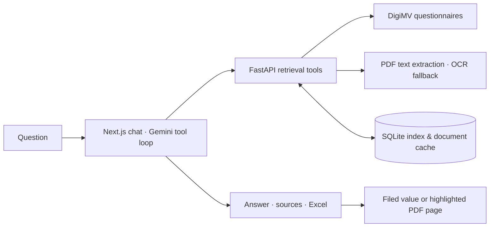

# Jaarverslagen Zorg

[](https://github.com/FrisoWiegersma/jaarverantwoording-zorg/actions/workflows/checks.yml)

Ask questions about Dutch healthcare annual reports, and see where every figure comes from.

[](docs/demo.mp4)

<sub>Recorded in the running app with public data. Waiting for the model is cut.</sub>

It reads the public [DigiMV archive](https://digimv13.desan.nl/archive/search), where Dutch healthcare providers file their annual accounts. The interface and the answers are in Dutch.

## What it does

- **Ask** about revenue, results, equity or staff, for one organisation or a few side by side, from 2019 on.
- **Check the source.** Every amount links to its passage, highlighted on the PDF page, or to the field filed in the DigiMV questionnaire.
- **Look an organisation up** with ⌘K or Ctrl K and read its key figures over the years. This reads DigiMV directly, without the model.
- **Compare** two to four organisations on shared chart scales, with the filed values in a table beneath.
- **Export** an answer's table to Excel, with numeric cells and links to the sources, or copy it into a spreadsheet.
- **Look past the annual report.** The chat also reads the care-provider register (permits, AGB codes, branches), what municipalities, youth-care regions, provinces and water boards spend per policy area (CBS Iv3), and court rulings. An Iv3 amount links to its cell.
- **Find the buried PDF.** It searches Woo releases, gazettes and parliamentary papers, local regulations and EU tenders, follows links on any public site (insurers' purchasing policies, IZA regional plans, council portals), reads the PDF and quotes the page. Open data too: data.overheid.nl, CSV/Excel files and every CBS StatLine table.
- **Work in projects.** Signed-in consultants can upload PDFs and notes, keep context and conversations together, and inspect evidence from public and private sources. Private material is sent to Gemini only after enabling that project’s permission; see [project setup and privacy](docs/projects.md).
- **Pick up later.** Conversations are saved, an answer keeps running if the connection drops, and the bell tells you when it is done.

The same retrieval tools work from a CLI, an HTTP API and an MCP server ([reference](docs/reference.md)).

## Run it

You need Docker with Compose and a Gemini API key.

```sh
cp .env.example .env   # set GEMINI_API_KEY
docker compose up -d --build --wait
```

Open **http://localhost:3210**. The first start builds the archive index in the background; let it finish before you ask anything. Try:

> Toon de omzet van Stichting Basalt van 2021 tot en met 2024 in een grafiek.

Chat and OCR of scanned pages use the Gemini API. Search, caching and PDF text extraction run locally. The [Docker guide](docs/docker.md) covers indexing, configuration, updates and backups.

## How it works



The model finds the organisation, reads its filing and answers with sourced rows. Filed questionnaire values come first, because they keep their label, unit, year and scope. PDF pages fill in the rest: their text is extracted locally, and only pages that are images go to Gemini for OCR. Group totals and an entity's own accounts are kept apart. The [architecture notes](docs/architecture.md) go into the tool loop, validation, caching and tradeoffs.

## Limits

- The model and OCR can be wrong. Check the source, especially the unit, the year and whether a figure is for the whole group.
- A citation match is a text check, not an audit.
- A first read can be slow while a document downloads and converts, and it needs DigiMV and Gemini to be up.
- Conversations are saved on the server. A local setup shares one identity between everyone who uses it.
- Excel files are checked programmatically; pasting into Microsoft Excel still needs checking by hand.

## Repository

| Path | Contents |
| --- | --- |
| `digimv.py` | Indexing, retrieval, extraction, caching and the CLI |
| `api.py`, `mcp_server.py` | HTTP and MCP on top of the retrieval functions |
| `web/` | The Next.js app: chat, organisation pages, comparisons, sources and Excel export |
| `test_digimv.py`, `web/lib/*.test.ts` | Offline tests, run in [CI](.github/workflows/checks.yml) with lint, type checks and a build |

Not affiliated with DigiMV or with the organisations whose reports it reads. Code under the [MIT licence](LICENSE).
