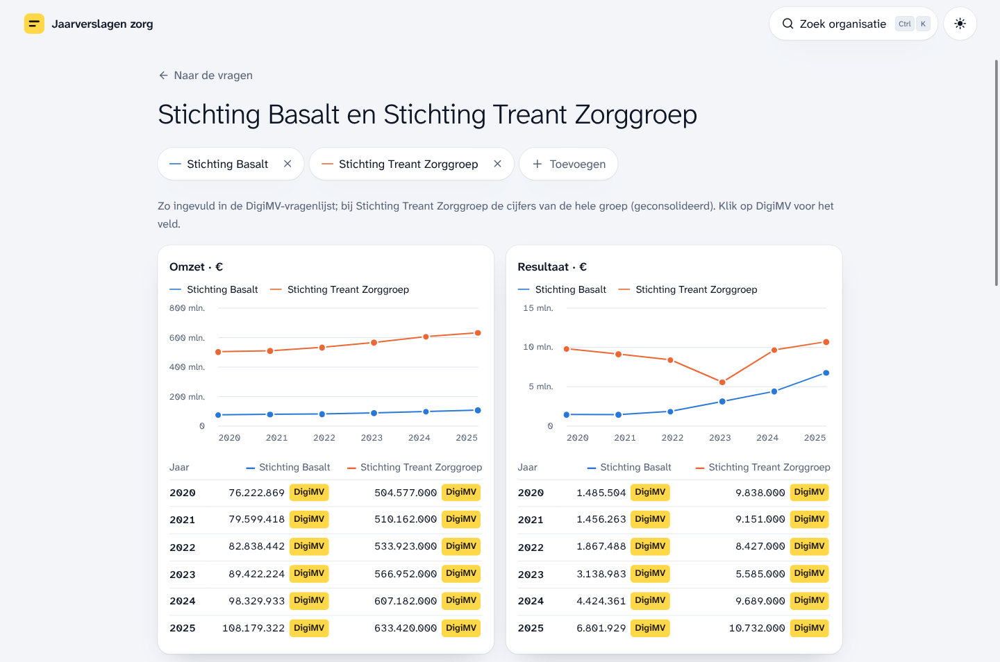
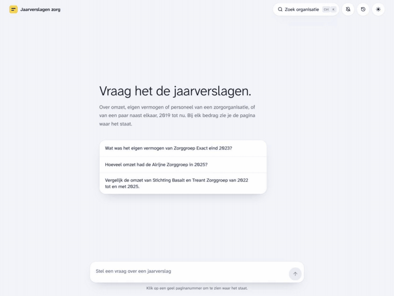
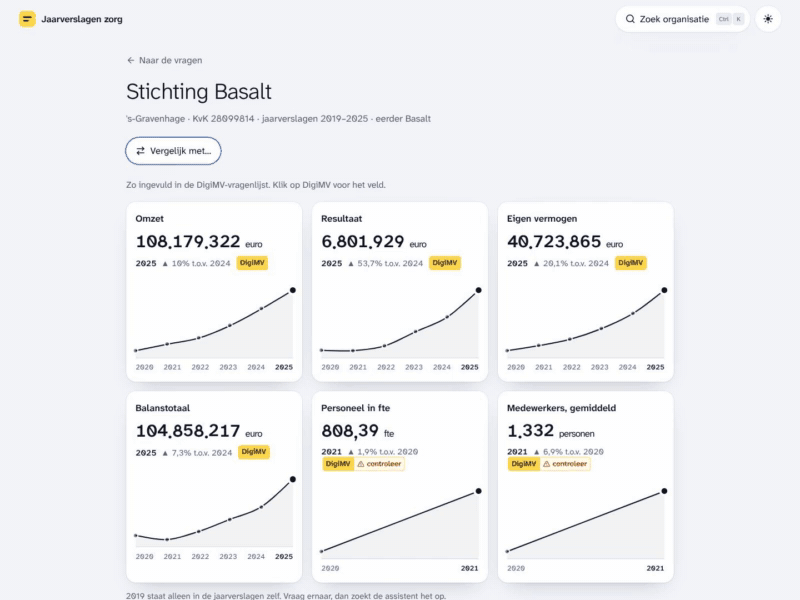
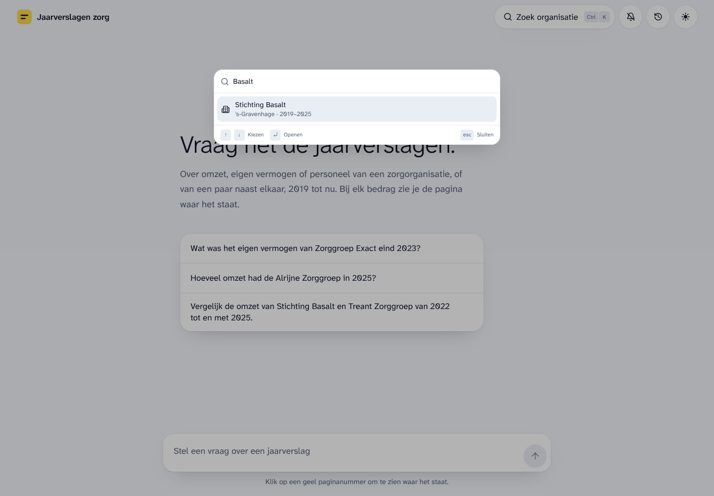
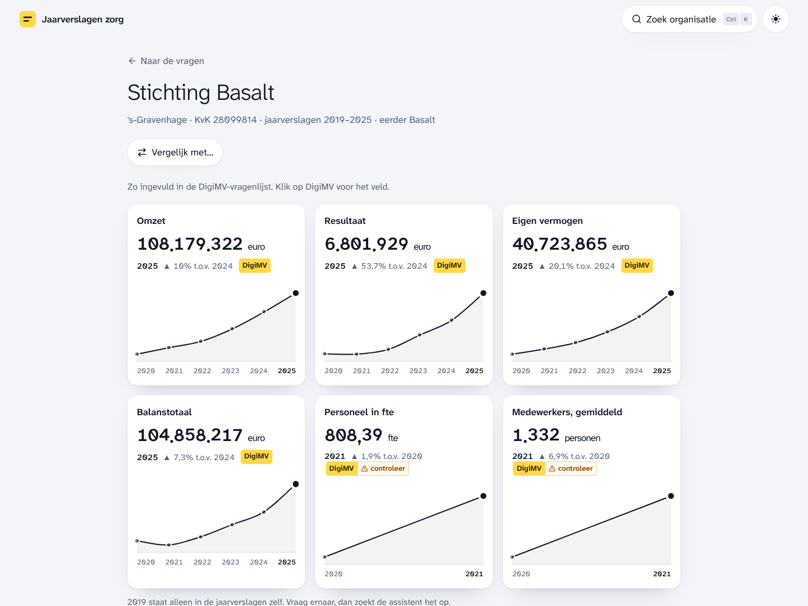
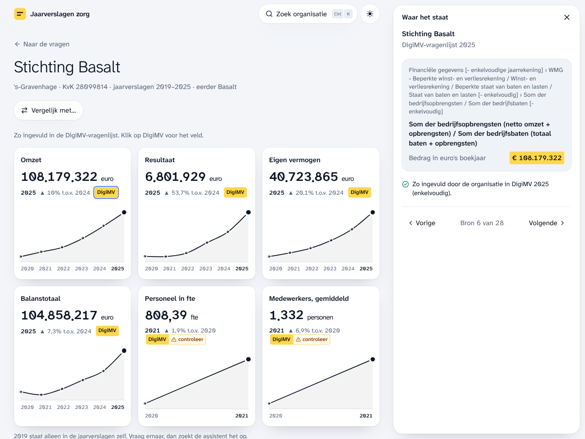
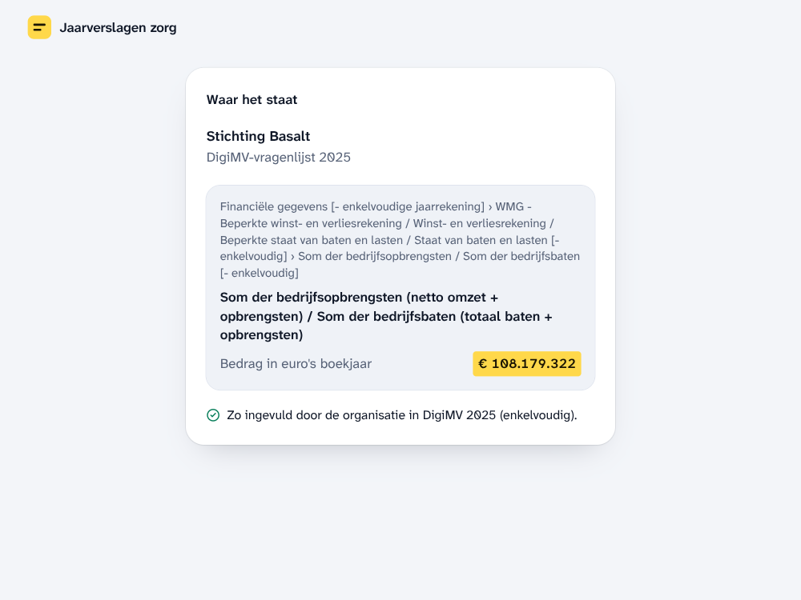
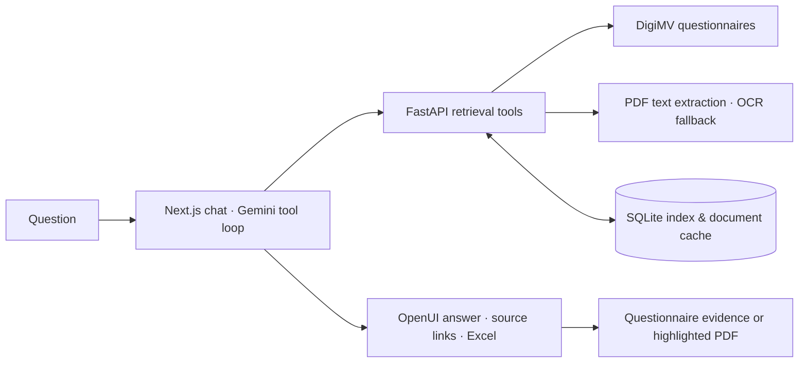

# Jaarverslagen Zorg

[](https://github.com/FrisoWiegersma/jaarverantwoording-zorg/actions/workflows/checks.yml)

Explore Dutch healthcare annual reports. Browse an organisation’s key figures, compare providers across years, and trace each amount back to its source. Ask follow-up questions and export answers to Excel.

A side project exploring tool-using AI for financial documents: structured retrieval, PDF extraction, source evidence, and a small generative UI. The interface and answers are in Dutch.



[Demos](#short-demos) · [Screenshots](#page-gallery) · [Docker setup](docs/docker.md) · [Architecture](docs/architecture.md) · [CLI, API & MCP](docs/reference.md) · [Checks](.github/workflows/checks.yml)

## From an organisation to a usable figure

- Find an organisation by name with the search button or **Ctrl/⌘ K**, then open its profile.
- Read revenue, result, equity, assets, and staffing over time. Hover, drag, or use arrow keys to inspect a year and its source.
- Compare **two to four organisations** on shared chart scales, with the exact filed values side by side. Profiles and comparisons read DigiMV directly, without a model call.
- Ask about revenue, equity, results, or staffing across reporting years.
- Open a citation to inspect the filed questionnaire value or relevant PDF passage, or follow a direct source-page link.
- View figures as tables, cards, or comparison charts, with the same underlying source rows.
- Copy a table into a spreadsheet, or download an `.xlsx` with numeric cells and source hyperlinks.
- Reopen saved conversations and continue asking. Answers keep running through a dropped connection; turn on the bell for a notification when an answer finishes in another tab.
- Use the same retrieval tools through the CLI, HTTP API, or MCP server.

The archive’s organisation and document metadata is indexed locally. Questionnaire answers and PDFs are fetched when needed; this is not a pre-downloaded copy of the entire archive.

## Short demos

Real browser captures, trimmed to the interaction. Click a preview to open its silent MP4.

| Find an organisation and inspect its figures | Compare organisations and inspect the source |
| --- | --- |
| [](docs/demos/organisation-profile.mp4) | [](docs/demos/organisation-comparison.mp4) |
| Search → profile → year → source · [Watch MP4](docs/demos/organisation-profile.mp4) | Add organisation → compare → source · [Watch MP4](docs/demos/organisation-comparison.mp4) |

## Page gallery

Click a screenshot to inspect it at full size.

| Organisation search | Key figures and trends |
| --- | --- |
| [](docs/images/organisation-search.png) | [](docs/images/organisation-profile.png) |
| **Source beside the figures** | **Direct source page** |
| [](docs/images/profile-evidence.png) | [](docs/images/source-page.png) |

## Run with Docker

You need Docker with Compose and a Gemini API key.

```sh
cp .env.example .env
```

Set `GEMINI_API_KEY` in `.env`, then start the app:

```sh
docker compose up -d --build --wait
```

Open **http://localhost:3210**. The first start builds the archive index in the background; allow that to finish before asking a question. Try:

> Toon de omzet van Stichting Basalt van 2021 tot en met 2024 in een grafiek.

Chat and scanned-page OCR use the Gemini API. Search, caching, and PDF text extraction run locally. See the [Docker guide](docs/docker.md) for indexing status, configuration, updates, and backup/restore.

## How it works



The agent searches for an organisation, reads the relevant filing, and presents sourced rows. Questionnaire fields are the first retrieval path for financial figures; PDF pages provide context and cover information missing from the questionnaire.

| Decision | Reason |
| --- | --- |
| Structured figures first | Filed values retain their labels, units, reporting year, and source field. |
| SQLite full-text search | Organisation substrings and document text can be searched locally without a separate search service. |
| Text extraction before OCR | Read visible PDF text locally; send image-only pages to Gemini. Record which path produced each page. |
| Explicit reporting scope | Consolidated group totals and the legal entity’s own accounts are distinguished in tool results and model instructions. |
| Shared rows for UI and Excel | OpenUI cards and charts retain a source table; exports preserve numeric values and evidence links. |

The [architecture notes](docs/architecture.md) cover the tool loop, validation boundaries, caching, and tradeoffs.

## Evidence in the interface

| PDF passage | Filed questionnaire value |
| --- | --- |
|  |  |

PDF citations report whether the quoted passage was found fully, partly, or not at all. Questionnaire citations show the field’s place in the form and its filed value. These checks help a reader inspect the evidence; they do not establish that the model chose the right accounting concept.

<details>
<summary>Mobile view</summary>

<p></p>

Profile cards stack on a phone. Tables scroll within their cards or answers, and source evidence opens in a bottom drawer. Light and dark themes follow the device setting unless you choose one with the theme button.

</details>

## Checks and current limits

[GitHub Actions](.github/workflows/checks.yml) runs frontend lint, type checks, unit tests, and a production build, plus the Python image’s offline self-check. The checks do not need a real Gemini key or a downloaded archive.

Tests cover organisation identity across years, search, extraction and OCR routing, cached figures, citation parsing, Dutch number formats, OpenUI arguments, and Excel link validation. Manual browser checks exercise real questions, evidence panels, mobile layouts, and workbook downloads. There is no formal end-to-end accuracy benchmark yet.

- Model interpretation and OCR can be wrong. Review the source, especially its unit, year, and consolidation scope.
- A citation match is a text check, not an accounting audit. The app is an aid to reading reports.
- Slow first reads may include downloading and converting a document. Availability also depends on DigiMV and Gemini.
- Conversations are saved on the server. The private deployment separates them by signed-in user; the local setup uses a shared default identity.
- Excel files have been inspected programmatically. Pasting into Microsoft Excel still needs a manual compatibility check.

## Repository

| Location | Contents |
| --- | --- |
| `digimv.py` | Indexing, retrieval, extraction, caching, and CLI |
| `api.py`, `mcp_server.py` | HTTP and MCP interfaces over the retrieval functions |
| `web/` | Organisation profiles, comparisons, Next.js chat, saved conversations, source evidence, and Excel export |
| `test_digimv.py`, `web/lib/*.test.ts` | Offline Python checks and frontend unit tests |

Data comes from the public [DigiMV archive](https://digimv13.desan.nl/archive/search). This project is independently built and is not affiliated with DigiMV or the organisations whose reports it reads. The hosted instance is private; the recordings, screenshots, and local setup above are the public demo.

Code is licensed under [MIT](LICENSE). Source-file notices credit third-party components.
