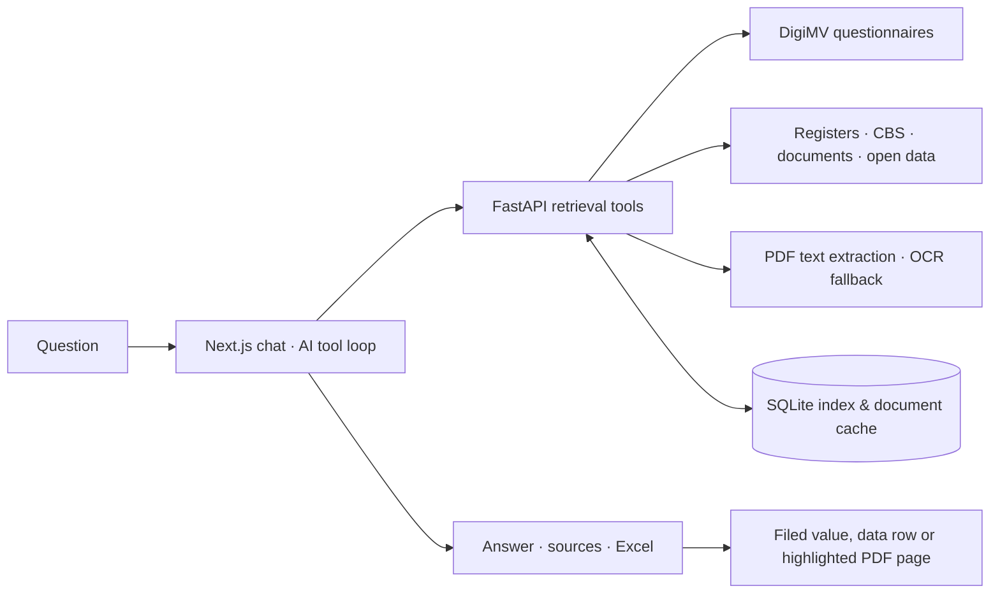

# Jaarverslagen Zorg

[](https://github.com/FrisoWiegersma/jaarverantwoording-zorg/actions/workflows/checks.yml)

Ask questions about Dutch healthcare and government data, public or your own, and see where every figure comes from.

[](docs/demo.mp4)

<sub>Recorded in the running app with public data. Waiting for the model is cut.</sub>

It searches the annual accounts care providers file in [DigiMV](https://digimv13.desan.nl/archive/search) and [17 other public sources](#sources): registers, CBS tables, court rulings, Woo releases, tenders and any public PDF. It also searches the PDFs and notes you upload to a project. Every figure links to the page, filed field or data row it came from, because the consultants it is made for have to show their sources to the care providers and governments they advise. The interface and the answers are in Dutch.

## Install

```sh
curl -fsSL https://raw.githubusercontent.com/FrisoWiegersma/jaarverantwoording-zorg/main/install.sh | bash
```

You need git, Docker with Compose and an API key for Gemini, Claude, OpenAI or DeepSeek. The [script](install.sh) puts the code in `~/jaarverantwoording-zorg`, asks for your provider and its key, builds and starts the app and opens **http://localhost:3210**, where you create an account. Run it again to update; `.env` and your data stay.

The first start builds the archive index in the background, which takes a few minutes. Then try:

> Toon de omzet van Stichting Basalt van 2021 tot en met 2024 in een grafiek.

The same by hand:

```sh
git clone https://github.com/FrisoWiegersma/jaarverantwoording-zorg.git && cd jaarverantwoording-zorg
cp .env.example .env   # set your provider's key
docker compose up -d --build --wait
```

Set as many providers in `.env` as you like, including Ollama, OpenRouter or anything else that speaks the OpenAI API; you pick the model per question. The [Docker guide](docs/docker.md) covers configuration, sign-in through Cloudflare Access, updates, backups and automatic deploys. To work on the code without Docker, see [web/README.md](web/README.md).

## What it does

- **Ask** about revenue, results, equity or staff, for one organisation or a few side by side, from 2019 on. Pick the model and how hard it thinks for each question; a meter shows how full its context is.
- **Check the source.** Every figure links to its passage highlighted on the PDF page, to the field filed in the DigiMV questionnaire, to the row of a data file or to the CBS cell.
- **Look an organisation up** with ⌘K or Ctrl K and read its key figures over the years, straight from DigiMV, without the model.
- **Compare** two to four organisations on shared chart scales, with the filed values in a table beneath.
- **Export** an answer's table to Excel, with numeric cells and links to the sources, or copy it into a spreadsheet.
- **Find the buried PDF.** It searches Woo releases, gazettes and parliamentary papers, local regulations, EU tenders and regulators' decisions, follows links on any public site (insurers' purchasing policies, IZA regional plans, council portals), reads the PDF and quotes the page.
- **Read open data.** CSV, Excel and JSON files, also inside ZIP and 7z archives, filtered on a column or ranked for a top-N question, with a citation per row. Every CBS StatLine table too.
- **Work in projects.** Upload PDFs, Markdown notes or a whole folder, keep instructions and conversations together, and save the files an answer cites into one or more projects, so later chats can still read them when the public link has expired. Private material is sent to the AI provider only after you allow it for that project; see [projects and privacy](docs/projects.md).
- **Pick up later.** Conversations are saved, an answer keeps running if the connection drops, and the bell tells you when it is done.
- **Your own account.** Sign in with email and password, or through Cloudflare Access. Conversations and projects belong to their owner.

## Sources

| | |
| --- | --- |
| Care providers | [DigiMV](https://digimv13.desan.nl/archive/search) annual reports and questionnaires, the care-provider register [LRZa](https://zoeken.zorgaanbiedersportaal.nl/) (permits, AGB codes, branches), [Zorginzicht](https://www.zorginzicht.nl/) quality indicators, [NZa Open DIS](https://opendisdata.nza.nl/) care products and prices, [Vektis](https://www.vektis.nl/) and [Zorgcijfersdatabank](https://www.zorgcijfersdatabank.nl/) care costs |
| Figures | CBS Iv3 (what municipalities, regions, provinces and water boards spend per policy area), every [CBS StatLine](https://opendata.cbs.nl/) table, RIVM StatLine behind VZinfo, [Prognosemodel Zorg en Welzijn](https://prognosemodelzw.nl/) (with a free key) |
| Law and government | KVK Handelsregister open data, [court rulings](https://www.rechtspraak.nl/uitspraken), [Woo releases](https://open.overheid.nl/), [gazettes and parliamentary papers](https://www.officielebekendmakingen.nl/), [local regulations](https://lokaleregelgeving.overheid.nl/), regulators' decisions on [PUC](https://puc.overheid.nl/) |
| Open web | [EU tenders](https://ted.europa.eu/), [data.overheid.nl](https://data.overheid.nl/) datasets, and any public PDF, Word, HTML or XML page by its URL |

The HTTP API also looks up LEI records and the EU sanctions list. [Data sources](docs/data-sources.md) lists what each source holds, how it is reached, and what was looked at and left out.

## How it works



### Tool loop

The chat route runs the chosen model through the AI SDK with 32 tools: 28 over the public sources and 4 over the project's own files. The model is told to research in parallel and to search before it reads. A question gets 24 research rounds or 600,000 tokens, whichever runs out first, then up to 3 rounds that may only present what was found. Older tool results are pruned from later turns, so a long conversation doesn't keep paying for documents it has already read.

### Checked output

Figures come back through a `present_answer` tool. Zod checks every row: one figure, Dutch number notation and a well-formed citation path. A validation error goes back to the model to correct. The server then writes the rows as an [OpenUI](https://openui.com) program, so the model chooses between a table, cards and a chart without writing any UI code itself. A Markdown version is built from the same rows, so a rendering error never hides the answer.

### Grounding

A citation names a document, a page and a quote, and the API looks for that quote on the rendered page and reports whether it found all of it, part of it or none. Values filed in the DigiMV questionnaire come before PDF text, because they keep their label, unit, year and scope. Group totals and an entity's own accounts are kept apart. What a source doesn't have is reported as missing, and a document that wasn't read is never reported as saying nothing.

### Documents

PDF text is extracted locally with PyMuPDF; only pages that are images go to an OCR model (Gemini, Claude, OpenAI or a vision model on your own server). Extracted pages are cached against the filing's publication data and the extractor's version, so a corrected filing or a better extractor triggers a new read. Search is SQLite FTS5, with accent-insensitive trigrams for names and filed fields and word prefixes for pages, rather than embeddings: the people using it need the exact passage, with the words they searched for.

### Interrupted connections

Answers stream over SSE with keepalives. The question is saved before the model starts, with a checkpoint after every step, and a client that reconnects replays the stream from the server for up to 15 minutes after the answer finishes. A dropped API call is retried once. Every failed tool call is logged with its input and error to a file that survives redeploys.

### Safety

URLs the model picks must resolve to a public address, also after every redirect, and the site's `robots.txt` must allow the read. ZIP and 7z members are extracted one at a time into bounded temporary files. Private project material reaches a provider only when that project allows it, and the server checks that permission again on every call, OCR retry and model step.

### Other ways in

The same retrieval tools are available from a CLI, an HTTP API and an MCP server ([reference](docs/reference.md)). The [architecture notes](docs/architecture.md) go further into the tool loop, validation, caching and tradeoffs.

## Checks and deploys

Python and TypeScript have offline tests (`tests/`, `web/lib/*.test.ts`) that run in [CI](.github/workflows/checks.yml) with ruff, ESLint, type checks and a production build. The API's Docker image runs the Python tests while it builds, so a failing test stops the build. A systemd timer on the server deploys `main` once every check on it has passed, and rolls back to the previous commit if the build or health check fails ([deploy/](deploy/)).

## Limits

- The model and OCR can be wrong. Check the source, especially the unit, the year and whether a figure is for the whole group.
- A citation match is a text check, not an audit.
- There is no scored test set of financial questions yet; behaviour is checked with regression tests and by hand in the browser.
- A first read can be slow while a document downloads and converts, and it needs the source and the AI provider to be up.
- The app has no rate limiting, and the built-in login does not verify email addresses. On a public address, close sign-up once everyone has an account (`AUTH_ALLOW_SIGNUP=false`).
- Excel files are checked programmatically; pasting into Microsoft Excel still needs checking by hand.

## Repository

| Path | Contents |
| --- | --- |
| `api/` | Python: DigiMV indexing and extraction (`digimv.py`), the other sources (`sources.py`, `documents.py`, `datasets.py`), projects (`projects.py`, `project_files.py`), and HTTP (`main.py`) and MCP (`mcp_server.py`) on top |
| `web/` | The Next.js app: login, chat and its tools, organisation pages, comparisons, projects, the evidence panel and Excel export |
| `tests/`, `web/lib/*.test.ts` | Offline tests |
| `install.sh` | The one-line install and update |
| `deploy/` | The systemd timer that deploys `main` once its checks pass |
| `docs/` | Architecture, data sources, Docker, projects and the API/CLI/MCP reference |

Not affiliated with DigiMV or with the organisations whose reports it reads. Code under the [MIT licence](LICENSE).
