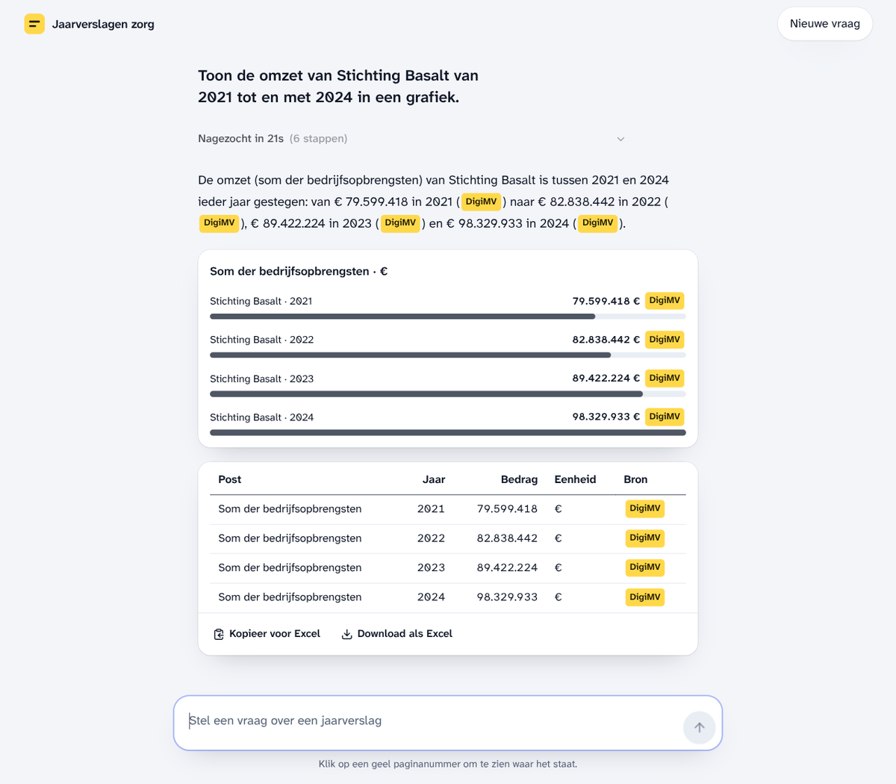
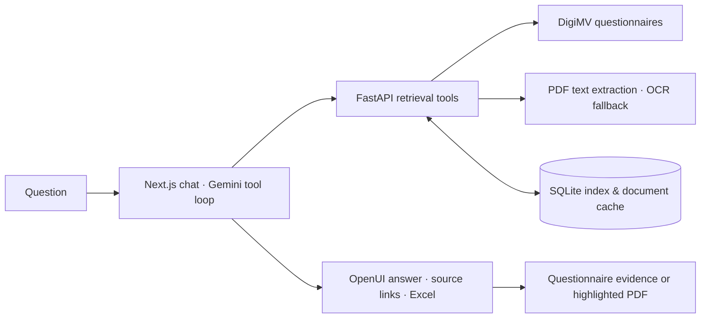
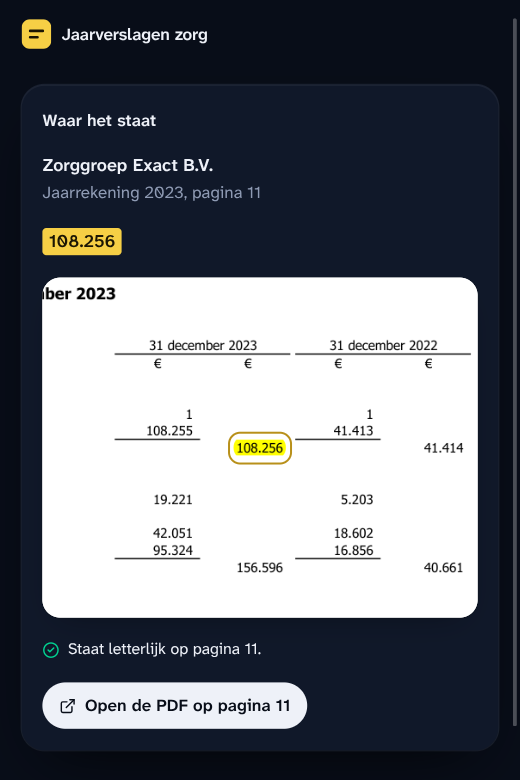
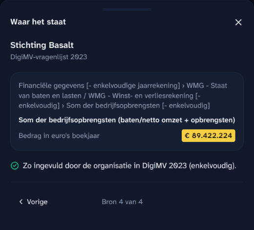
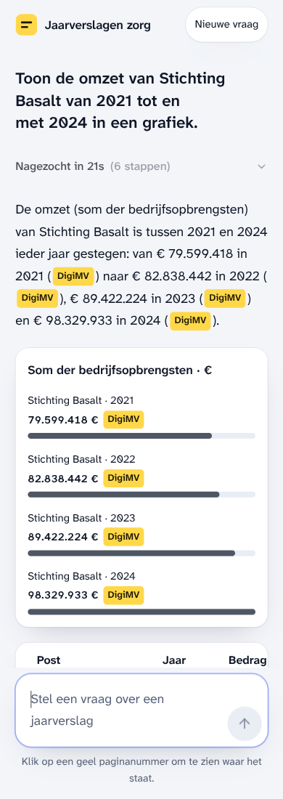

# Jaarverslagen Zorg

[](https://github.com/FrisoWiegersma/jaarverantwoording-zorg/actions/workflows/checks.yml)

Ask questions about Dutch healthcare annual reports. Trace figures back to their source and export them to Excel.

A side project exploring tool-using AI for financial documents: structured retrieval, PDF extraction, source evidence, and a small generative UI. The interface and answers are in Dutch.



[Docker setup](docs/docker.md) · [Architecture](docs/architecture.md) · [CLI, API & MCP](docs/reference.md) · [Checks](.github/workflows/checks.yml)

## From a question to a usable figure

- Ask about revenue, equity, results, or staffing across reporting years.
- Open a citation to inspect the filed questionnaire value or the relevant PDF passage.
- View figures as tables, cards, or comparison charts, with the same underlying source rows.
- Copy a table into a spreadsheet, or download an `.xlsx` with numeric cells and source hyperlinks.
- Use the same retrieval tools through the CLI, HTTP API, or MCP server.

The archive’s organisation and document metadata is indexed locally. Questionnaire answers and PDFs are fetched when needed; this is not a pre-downloaded copy of the entire archive.

## Run with Docker

You need Docker with Compose and a Gemini API key.

```sh
cp .env.example .env
```

Set `GEMINI_API_KEY` in `.env`, then start the app:

```sh
docker compose up -d --build --wait
```

Open **http://localhost:3210**. The first start builds the archive index in the background; allow that to finish before asking a question. Try:

> Toon de omzet van Stichting Basalt van 2021 tot en met 2024 in een grafiek.

Chat and scanned-page OCR use the Gemini API. Search, caching, and PDF text extraction run locally. See the [Docker guide](docs/docker.md) for indexing status, configuration, updates, and backup/restore.

## How it works



The agent searches for an organisation, reads the relevant filing, and presents sourced rows. Questionnaire fields are the first retrieval path for financial figures; PDF pages provide context and cover information missing from the questionnaire.

| Decision | Reason |
| --- | --- |
| Structured figures first | Filed values retain their labels, units, reporting year, and source field. |
| SQLite full-text search | Organisation substrings and document text can be searched locally without a separate search service. |
| Text extraction before OCR | Read visible PDF text locally; send image-only pages to Gemini. Record which path produced each page. |
| Explicit reporting scope | Consolidated group totals and the legal entity’s own accounts are distinguished in tool results and model instructions. |
| Shared rows for UI and Excel | OpenUI cards and charts retain a source table; exports preserve numeric values and evidence links. |

The [architecture notes](docs/architecture.md) cover the tool loop, validation boundaries, caching, and tradeoffs.

## Evidence in the interface

| PDF passage | Filed questionnaire value |
| --- | --- |
|  |  |

PDF citations report whether the quoted passage was found fully, partly, or not at all. Questionnaire citations show the field’s place in the form and its filed value. These checks help a reader inspect the evidence; they do not establish that the model chose the right accounting concept.

<details>
<summary>Mobile view</summary>

<p></p>

Tables scroll within the answer. Source evidence opens in a bottom drawer. Light and dark themes follow the device setting.

</details>

## Checks and current limits

[GitHub Actions](.github/workflows/checks.yml) runs frontend lint, type checks, unit tests, and a production build, plus the Python image’s offline self-check. The checks do not need a real Gemini key or a downloaded archive.

Tests cover organisation identity across years, search, extraction and OCR routing, cached figures, citation parsing, Dutch number formats, OpenUI arguments, and Excel link validation. Manual browser checks exercise real questions, evidence panels, mobile layouts, and workbook downloads. There is no formal end-to-end accuracy benchmark yet.

- Model interpretation and OCR can be wrong. Review the source, especially its unit, year, and consolidation scope.
- A citation match is a text check, not an accounting audit. The app is an aid to reading reports.
- Slow first reads may include downloading and converting a document. Availability also depends on DigiMV and Gemini.
- Conversations stay in the current browser tab; there is no saved chat history.
- Excel files have been inspected programmatically. Pasting into Microsoft Excel still needs a manual compatibility check.

## Repository

| Location | Contents |
| --- | --- |
| `digimv.py` | Indexing, retrieval, extraction, caching, and CLI |
| `api.py`, `mcp_server.py` | HTTP and MCP interfaces over the retrieval functions |
| `web/` | Next.js chat, OpenUI answers, source evidence, and Excel export |
| `test_digimv.py`, `web/lib/*.test.ts` | Offline Python checks and frontend unit tests |
| `openui-agent/` | Separate OpenUI/LangGraph weather experiment; not part of the healthcare app or Compose stack |

Data comes from the public [DigiMV archive](https://digimv13.desan.nl/archive/search). This project is independently built and is not affiliated with DigiMV or the organisations whose reports it reads. The hosted instance is private; the screenshots and local setup above are the public demo.

Code is licensed under [MIT](LICENSE). Source-file notices credit third-party components.
