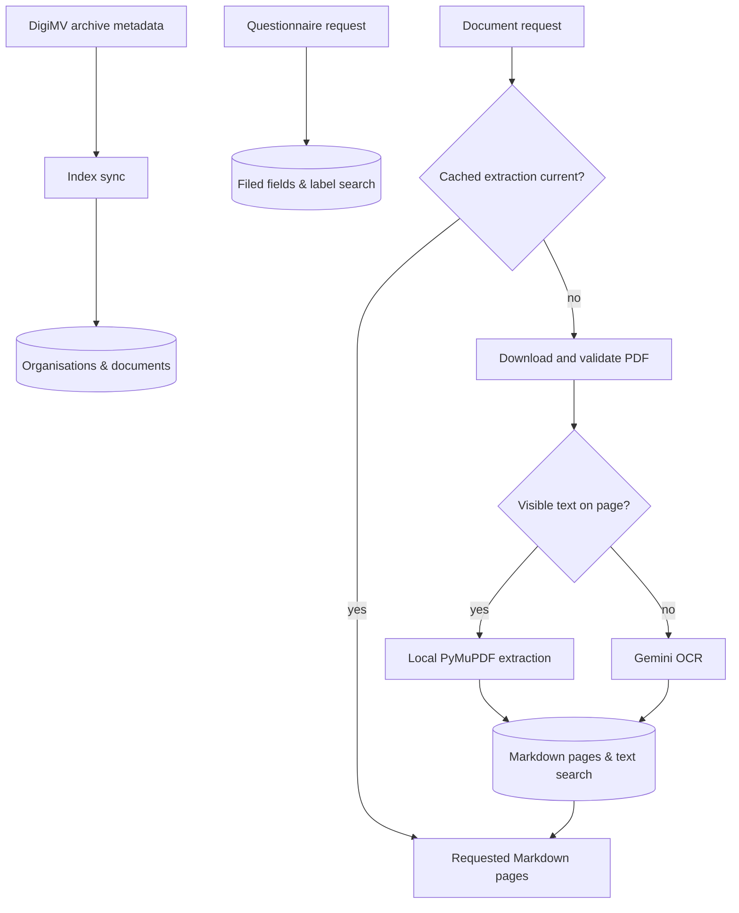

# Architecture

[Back to the README](../README.md)

## Request flow

1. The Next.js chat route runs the chosen model (Gemini, Claude, DeepSeek, OpenAI or an OpenAI-compatible server) through the AI SDK. The browser receives tool progress and answer parts over the same stream.
2. `search_organizations` identifies the organisation and its documents. Document keys include both year and document ID because IDs restart each year.
3. `get_figures` retrieves questionnaire fields with their label paths, values, units, and variable names. The result distinguishes group accounts from single-entity filings. Field names vary across years, so searches use labels.
4. `get_document` downloads and extracts a document on its first read, then returns requested pages. `search_documents` searches pages already indexed in the cache.
5. `present_answer` accepts a short summary and sourced figure rows. Zod checks the input shape, Dutch numeric notation, and citation paths. The server serializes validated arguments into an OpenUI `FinancialAnswer` program.
6. The client renders a table, cards, or chart. All views retain a source table and Excel controls. The Markdown fallback is generated from the same rows.

OpenUI supplies the renderer inside the existing chat, using the chosen model. Chart groups separate posts and units; negative values keep their sign and use a different bar colour.

## Retrieval and storage

SQLite uses WAL mode so cached reads can continue during an index refresh. Organisation and questionnaire searches use an accent-insensitive trigram index; extracted pages use word-prefix search. The Docker image includes a SQLite runtime supporting those tokenizers, runs the offline self-check at build time, and probes a real search at API startup.

Metadata refreshes in the background once it is older than 24 hours, checked hourly while the API runs. The document cache records publication information and extractor version, so updated filings or extraction changes can trigger a new conversion. An empty upstream year does not overwrite a populated index year.

PDF pages with an image and little visible text go through OCR. Invisible scanner text and short auditor stamps should not cause a scanned page to be treated as ordinary text. Each extracted page records its source; OCR output remains an interpretation of the image.

## Other sources

`sources.py` adds the care-provider register (LRZa), the accounts governments report to CBS (Iv3) and court rulings, with the same rules as DigiMV:
- values are kept as the source gives them, with that source;
- what a source lacks is reported as missing, never filled in;
- each function serves the CLI, API, MCP and chat alike.

Each source is fetched on first use and cached in `digimv.db`:
- **LRZa:** for 7 days.
- **Iv3:** per body and report, until CBS changes the table.
- **Rulings:** for 30 days.

`documents.py` finds public documents through each portal's own API (Woo, gazettes and parliamentary papers, CVDR, TED) and reads any public URL the way DigiMV reports are read: PDFs page by page through the same text-layer/OCR pipeline, Word, HTML and XML as text. Pages are cached per URL and indexed for search, and each page is cited by its URL with `#page=N`. `list_links` lists a page's links, so a document that is only linked from a site (insurers' purchasing policies, IZA regional plans, council documents) can be reached step by step. Because the model chooses these URLs, every fetch must resolve to a public address, also after redirects, and must be allowed by the site's `robots.txt`. A robots.txt that errors (5xx) means stay away, except on `puc.overheid.nl`, whose robots.txt answers HTTP 500 while its pages work; rules it does serve still apply.

`datasets.py` covers open data: the data.overheid.nl catalogue, CSV/XLSX/JSON files read as rows with their spreadsheet row numbers, and every CBS StatLine table (opendata and dataderden) with the same verbatim-key and 10,000-row rules as Iv3.

CSV files are streamed from a disk cache (up to 1 GB, a day), so only the header, the counts and the requested page are held in memory; filters match a named column exactly; a ZIP member can be read; Excel and JSON are read in memory up to 80 MB. A Swing client accesses ABF's Open Data Service behind Prognosemodel Zorg en Welzijn and Waarstaatjegemeente, with a key per site from the environment, the key only sent to that site, and missing values kept as null.

Network errors are never cached. Iv3 reads every dimension verbatim, because CBS pads keys inconsistently. It also fetches each report in chunks by policy area, because a query above 10,000 rows is refused rather than paged, and each chunk's count must match.

## Evidence and export

A PDF citation identifies a year, document, page, and quote. The API renders the page with matching text highlighted and reports `all`, `partial`, or `none`. A questionnaire citation identifies the organisation, year, and filed variable; the panel shows the label path and original value.

Neither mechanism proves the model selected the right entity, period, unit, or accounting concept. Those remain interpretation risks. Domain instructions guide the model to prefer group totals where relevant and to surface discrepancies between questionnaire and PDF values.

For Excel, the client extracts table rows and parses Dutch numeric notation. Clipboard output contains HTML numeric metadata and a text fallback. The download route validates the table and writes an ExcelJS workbook with numeric cells, formatting, a frozen header, source hyperlinks, and a question/source note. Hyperlinks must resolve to valid evidence paths on the configured app origin. Text beginning with `=` remains text in the workbook.

## Operating boundaries

- The tool loop stops after the presentation tool or the configured step limit. Older tool results are pruned from later turns to limit repeated document context; earlier answer links remain available.
- The prompt tells the model to re-read figures when their tool evidence is no longer in context. This is an instruction, not a guarantee of factual correctness.
- The API is internal to the Compose network. The frontend binds to host loopback. A remotely accessible deployment needs an authenticated reverse proxy; the application itself does not implement user accounts or rate limits.
- Provider credentials remain on the server. Scanned pages sent to Gemini for OCR are public report content, but questions and model context also reach the provider.
- The system has offline regression checks and manual browser validation, rather than a scored dataset of financial questions. Reported behaviour should be assessed with that limit in mind.

## Long answers and interrupted connections

A request gets up to 24 research rounds, followed by up to three rounds restricted to presenting the findings. The model must name missing information rather than silently exhaust its budget. A successful `present_answer` ends the loop; a validation error lets the model correct its input. Summaries are bounded at 60,000 characters and tables at 200 sourced figures. An unfinished turn gets an explicit continuation message.

The same conversation ID is used in its URL (`?gesprek=…`), saved history and live stream. The question is saved before generation, followed by a checkpoint after each model step and a final save. This also keeps old saved conversation IDs valid. No message text is stored in browser storage.

Both initial and replayed SSE streams send keepalives. Closing a client reader does not cancel server generation. On returning from a hidden page, reconnecting to the network or restoring a page from the browser cache, an unfinished client detaches its stale fetch and replays the server stream. Only the explicit Stop action aborts the server answer. The replay buffer remains in memory for 15 minutes after completion; after it expires, reopening the conversation reads its saved answer. A server restart still loses active generation, while saved checkpoints remain available.

`chat.finish` logs the request ID, step count, finish reason and whether a presentation succeeded. Every failed tool call (a step shown as *mislukt*) and every failed answer is logged as `chat.failure` and appended to `logs/errors.jsonl` in the `web-logs` volume, which survives redeploys: chat ID, model, step, tool, its input (cut at 2,000 characters; never for project tools) and the error. The question itself, uploads and credentials stay out.
